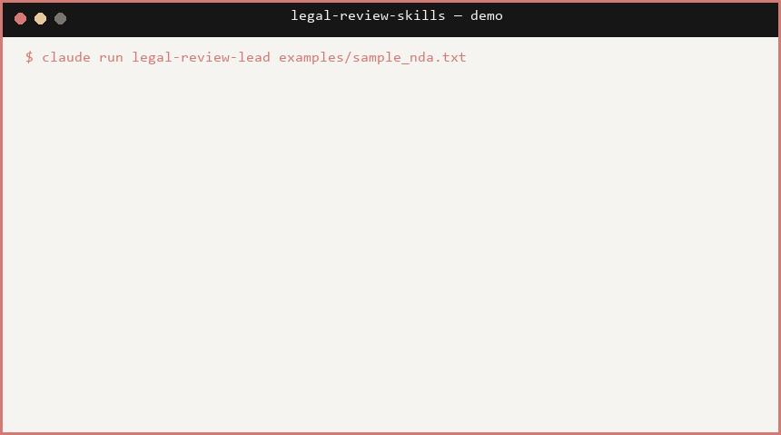

# Legal Review Skills for Small Firms

⭐ **Star this repo if it's useful** — and check out
[amagilabs/amagi-watch](https://github.com/amagilabs/amagi-watch), our CLI
that gives Claude video transcripts and key frames from any URL. More at
[amagilabs.ai](https://amagilabs.ai).

A Claude Code skills and subagents pack for first-pass review of NDAs, MSAs,
SaaS agreements, contractor agreements, and commercial or residential
leases. Built for small firms and solo attorneys who want an AI-assisted
first read before they put their own eyes, and their license, on a
document.

> ## This is not legal advice.
> Every finding, redline, risk score, and memo this pack produces is
> AI-generated drafting assistance. None of it is legal advice, none of it
> is a substitute for an attorney, and nothing it writes should be sent to
> a client or a counterparty until a licensed attorney in the governing
> jurisdiction has reviewed it. Treat all output as a first draft from a
> very fast, very literal junior associate who has never passed the bar.

## What's in the pack

**Skills** (`skills/`): reference material Claude Code loads on demand.

| Skill | What it covers |
|---|---|
| `contract-review-playbook` | Market positions, red flags, and fallback language for NDAs, MSAs/SaaS agreements, and contractor/vendor agreements. |
| `lease-review-playbook` | Same approach for commercial and residential leases. |
| `legal-citation-check` | The verify-or-flag rule for every statute, regulation, or case citation, plus clause-reference resolution. |
| `redline-format` | Output conventions for tracked-change-style redlines, including the two-variant (opening ask / fallback) pattern. |

**Agents** (`agents/`): a nine-agent review pipeline, orchestrated by
`legal-review-lead`.

1. `legal-clause-extractor` turns a document into a structured clause map.
2. `legal-playbook-checker` flags issues against the relevant playbook.
3. `legal-jurisdiction-researcher` verifies citations and adds jurisdiction-specific findings.
4. `legal-risk-scorer` rolls findings into a ranked, dollar-weighted risk matrix.
5. `legal-redline-drafter` drafts replacement language for material findings.
6. `legal-negotiation-strategist` builds a concession ladder for each redline.
7. `legal-client-memo-writer` writes a one-page, plain-English summary for the client.
8. `legal-adversarial-reviewer` runs an independent second pass that hunts for hallucinated findings or quotes.
9. `legal-review-lead` runs the above in sequence and assembles the attorney sign-off package.

Every agent in the pipeline treats its output as a draft for the next
agent, or the attorney, to check. Nothing is final until a human with a
bar card says so.

## Install

```
pipx install amagi-legal-review-skills
amagi-legal-review-skills install
```

That copies the skills into `~/.claude/skills/` and the agents into
`~/.claude/agents/`, which is where Claude Code loads them from. It skips
files you already have unless you pass `--force`; `--dry-run` shows what it
would write, and `--dest` points it at a different Claude Code folder.
`amagi-legal-review-skills list` shows what is bundled.

To copy the files by hand instead:

```bash
# from inside this repo
cp -r skills/* ~/.claude/skills/
cp agents/*.md ~/.claude/agents/
```

On Windows (PowerShell):

```powershell
Copy-Item -Recurse skills\* "$env:USERPROFILE\.claude\skills\"
Copy-Item agents\*.md "$env:USERPROFILE\.claude\agents\"
```

Restart Claude Code (or start a new session) so it picks up the new
skills and agents. You can confirm the agents are registered by asking
Claude Code to list available agent types, or by typing a request like
"review this lease" and checking that it routes to `legal-review-lead`.

## Worked example

`examples/sample_nda.txt` is a short, fictional mutual NDA between two
invented companies, with no real parties and no real deal terms.
`examples/example_run.md` walks through what the `contract-review-playbook`
skill flags in that NDA: an uncapped, one-directional indemnity clause
dressed up inside a nominally mutual agreement, a missing trade-secret
notice, and a couple of minor drafting notes. It also shows one example
redline in the pack's two-variant format.

Run it yourself: point `legal-review-lead` at `examples/sample_nda.txt`
and ask it to review the NDA. Expect a clause map, a findings list, a
risk matrix, draft redlines, a negotiation plan, a client memo, and an
adversarial pass, each gated on the sign-off checklist at the end of
`legal-review-lead`'s pipeline.

## Why this exists

Reviewing a routine NDA or commercial lease by hand is slow and the
issues repeat across documents: the same handful of red flags, the same
missing clauses, the same negotiation moves. This pack encodes that
repetition into a checklist-driven pipeline so an attorney's first pass
starts from a marked-up draft instead of a blank page, while keeping
every legal judgment call, every citation, and every send decision in
the attorney's hands.

## License

MIT. See `LICENSE`. Copyright (c) 2026 AmagiLabs.

## Contributing

This pack ships as a starting point, not a finished product. Playbook
coverage is currently strongest for NDAs, MSA/SaaS agreements, and
Georgia-first commercial and residential leases; other document types and
jurisdictions will need their own playbook files (see the "Playbooks"
table inside each skill's `SKILL.md`) before the pipeline covers them
well. Pull requests that add playbook coverage, tighten the citation
allowlist, or improve the adversarial-review checks are welcome.
